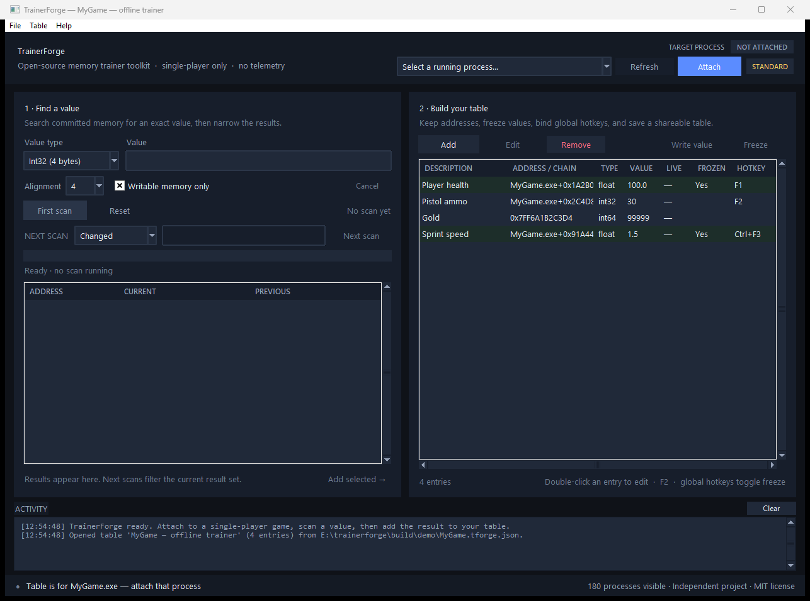

# TrainerForge

<p align="center">
  
</p>

<p align="center">
  <strong>أداة مفتوحة المصدر لبناء وتشغيل مدربات الألعاب الفردية على ويندوز، محليًا وبدون حساب أو سحابة.</strong>
</p>

<p align="center">
  <a href="README.md">English README</a>
</p>

TrainerForge برنامج مستقل مكتوب من الصفر باستخدام Python وواجهة Tkinter وواجهات
ويندوز الرسمية للذاكرة. يتيح لك الارتباط بعملية لعبة فردية، والبحث عن قيمة في
الذاكرة، وتضييق النتائج، ثم إنشاء «جدول» قابل للحفظ والمشاركة يحتوي على العناوين
وسلاسل المؤشرات والقيم المجمّدة والاختصارات العامة.

البرنامج **لا يحتوي على أي غش جاهز لأي لعبة**، ولا ينزّل مدربات من الإنترنت، ولا
يتصل بأي خدمة. أنت من يبني الجدول ويشاركه.

> **لا علاقة له بـ WeMod أو Cheat Engine أو أي ناشر لعبة.** هو مشروع مستقل
> ونظيف الغرفة (clean-room). اقرأ ملاحظة البحث في
> [docs/WEMOD-ANALYSIS.md](docs/WEMOD-ANALYSIS.md).



## الميزات

- الارتباط بعمليات ويندوز 32-bit و64-bit مع عرض حجم المؤشر ونوع البنية.
- البحث الدقيق عن قيم `Int32` و`Int64` و`Float` و`Double`.
- تصفية النتائج: قيمة محددة، تغيّرت، لم تتغيّر، زادت، نقصت.
- خيار «الذاكرة القابلة للكتابة فقط» ومحاذاة العنوان (1/2/4/8).
- عناوين مباشرة، أو قاعدة نسبة إلى وحدة مثل `Game.exe+0x1A2B0`.
- سلاسل مؤشرات متعددة المستويات تُحلّ باستخدام `ReadProcessMemory`.
- تجميد القيم عبر خيط كتابة دوري.
- اختصارات لوحة مفاتيح عامة لتبديل التجميد.
- عمود قيمة حيّة وزر كتابة يدوية.
- جداول JSON نصية قابلة للمراجعة والمشاركة، مع حفظ ذرّي.
- لا حسابات، لا إعلانات، لا قياسات، لا اتصال شبكي.

## ما ليس فيه

- ليس بديلًا كاملًا عن كتالوج WeMod التجاري؛ لا توجد مدربات جاهزة.
- لا يدعم الألعاب الجماعية أو العمليات المحمية بـ anti-cheat.
- لا يقوم بحقن أكواد أو تحميل DLL أو تثبيت تعريفات.
- لا يبحث عن سلاسل المؤشرات تلقائيًا في هذه النسخة؛ يحلّها فقط إذا أدخلتها.

## البدء السريع

### خيار 1: الملف التنفيذي

نزّل `TrainerForge.exe` من صفحة **Releases** في المستودع وشغّله. الملف غير موقّع
رقميًا، لذا قد يعرض SmartScreen تحذيرًا. تحقّق من بصمة SHA-256 المنشورة إن أردت.

### خيار 2: من المصدر

المتطلبات: ويندوز 10/11 وPython 64-bit إصدار 3.10 أو أحدث.

```powershell
git clone https://github.com/xCaptainTroy/trainerforge.git
cd trainerforge
python -m trainerforge
```

لا توجد اعتماديات خارجية وقت التشغيل. Tkinter مرفق مع CPython على ويندوز.

بعد قبول تنبيه الاستخدام الفردي:

1. اختر لعبة فردية من قائمة **Target process** واضغط **Attach**.
2. اختر نوع القيمة وأدخل قيمة تراها في اللعبة (مثل الصحة `100`) واضغط
   **First scan**.
3. غيّر القيمة داخل اللعبة، ثم استخدم **Next scan** مع **Changed** أو
   **Exact value**، وكرّر حتى تبقى نتائج قليلة.
4. أضف النتيجة إلى الجدول، وحدّد القيمة، وفعّل **Freeze**، وأضف اختصارًا إن أردت.
5. احفظ الجدول كملف `.tforge.json`.

للتجربة بدون لعبة:

```powershell
python tools\demo_target.py
```

ستظهر سطر JSON يحتوي على قيمة اختبارية. اربط TrainerForge بعملية `python.exe`
المذكورة في `pid`، وابحث عن القيمة المطبوعة. هذا هدف اصطناعي وليس غشًا للعبة.

## الجداول وسلاسل المؤشرات

- **عنوان مباشر**: مثل `0x7FF6A1B2C3D4`. بسيط، لكنه غالبًا يتغيّر بعد إعادة
  تشغيل اللعبة.
- **سلسلة مؤشرات**: قاعدة مثل `Game.exe+0x1A2B0` ثم إزاحات مثل `0x10, 0x20`.
  يقرأ البرنامج مؤشرًا في كل مستوى ثم يضيف الإزاحة التالية؛ هذا ما يجعل الجدول
  يعيش بعد إعادة التشغيل.

صيغة الملف الكاملة في [docs/TABLE-FORMAT.md](docs/TABLE-FORMAT.md).

## السلامة

- للاستخدام مع الألعاب الفردية أو غير المتصلة التي تملكها فقط.
- لا يدعم الغش الجماعي أو تجاوز anti-cheat، ولا يحاول إخفاء نفسه.
- يحجب أسماء عمليات ويندوز الحرجة وعلامات مضادات الغش المعروفة كإجراء احترازي
  محدود، وليس كضمان أمني.
- تعديل الذاكرة قد يسبب انهيار اللعبة أو تلف الحفظ؛ خذ نسخة احتياطية.
- البرنامج بدون ضمان، وأنت مسؤول عن الالتزام بشروط اللعبة والقانون المحلي.

اقرأ [docs/SAFETY.md](docs/SAFETY.md) قبل الاستخدام.

## البناء

```powershell
python -m pip install -r requirements-dev.txt
.\build.ps1
```

النتيجة: `dist\TrainerForge.exe` مع ملف `TrainerForge.exe.sha256`. الملف غير موقّع
رقميًا. لا تستخدم PyInstaller على نظام غير ويندوز لبناء نسخة ويندوز.

## الاختبارات

```powershell
python -m pytest -q
python tools\ui_smoke_test.py
```

اختبارات التكامل تشغّل `tools/demo_target.py` وتتحقق من البحث والكتابة والتصفية
وحل سلسلة مؤشرات على ذاكرة عملية حقيقية.

## الترخيص

MIT — انظر [LICENSE](LICENSE). أسماء WeMod وWand وCheat Engine وأسماء الألعاب
علامات تجارية لأصحابها، وتُذكر للمقارنة والتعريف فقط.
